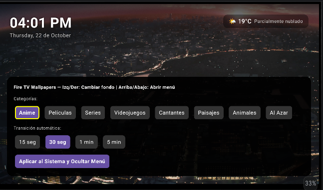
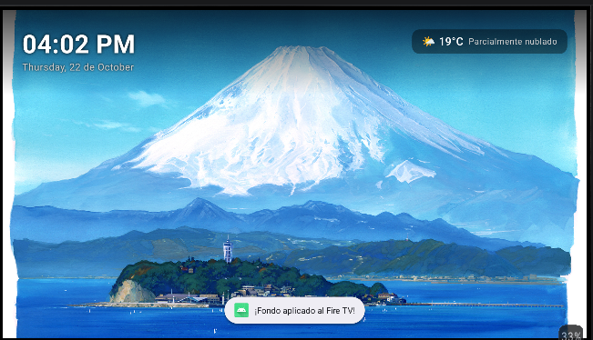
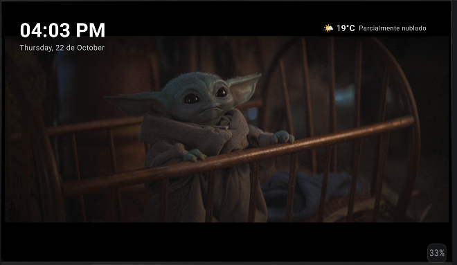
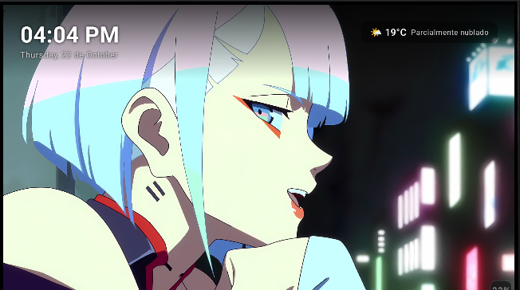

# 🔥 FireWallpapers

**Fondos dinámicos para Fire TV Stick, con categorías, transiciones y reloj en pantalla.**

FireWallpapers es una aplicación Android desarrollada con Kotlin y Jetpack Compose, pensada para explorar fondos de pantalla desde el televisor usando el control remoto. Permite elegir categorías, cambiar entre imágenes y configurar la frecuencia de transición.

## 📺 Dispositivo objetivo

- **Principal:** Amazon Fire TV Stick.
- **Plataforma:** Android / Fire OS compatible con las funciones utilizadas por la aplicación.
- **Interacción:** navegación con las flechas y el botón de selección del control remoto.

> La posibilidad de registrar el protector de pantalla del sistema depende de la versión y las restricciones de Fire OS. No está garantizado que todos los modelos permitan reemplazar el protector de pantalla predeterminado.

## ✨ Funcionalidades

- 🖼️ Fondos de pantalla con transición visual.
- 🎨 Categorías: Anime, Películas, Series, Videojuegos, Cantantes, Paisajes, Animales y Al Azar.
- ⏱️ Intervalos de cambio: 15 segundos, 30 segundos, 1 minuto y 5 minutos.
- 🕒 Reloj y fecha en pantalla.
- 🎮 Interfaz preparada para navegar con el control remoto.
- 🌐 Búsqueda de imágenes mediante la API de Wallhaven.
- 💾 Preferencias de categoría e intervalo guardadas para reutilizarlas en el servicio de protector de pantalla.

## 🧰 Tecnologías utilizadas

| Tecnología | Uso |
|---|---|
| Kotlin | Lenguaje principal |
| Android SDK | Plataforma de la aplicación |
| Jetpack Compose | Interfaz declarativa |
| Material 3 | Componentes visuales |
| Kotlin Coroutines | Operaciones asíncronas y temporizadores |
| Retrofit | Solicitudes HTTP a la API |
| Gson Converter | Conversión de respuestas JSON |
| Coil | Carga y visualización de imágenes |
| Android DreamService | Integración experimental con protector de pantalla |

## 🖼️ Capturas de pantalla

### Selección de categorías y tiempos

### Fondo aplicado en el televisor

### Ejemplos de fondos

> Las capturas se han extraído del documento de demostración proporcionado. Si publicas el repositorio como público, asegúrate de tener permiso para redistribuir las imágenes mostradas o sustitúyelas por capturas con fondos que tengas derecho a compartir.

## 🚀 Estado del proyecto

Proyecto en desarrollo. Las funciones disponibles pueden variar según la versión de Fire OS y el dispositivo. El indicador del clima mostrado en la interfaz es actualmente un valor de ejemplo y no representa datos meteorológicos en tiempo real.

## 🔧 Configuración y ejecución

1. Clona este repositorio.
2. Abre el proyecto con Android Studio.
3. Sincroniza Gradle.
4. Configura las credenciales necesarias para los servicios externos sin incluir claves privadas en el repositorio.
5. Ejecuta la aplicación en un dispositivo compatible o genera un APK para instalarlo en el Fire TV Stick.

## 🔐 Seguridad

No publiques claves API, contraseñas ni archivos locales. Si una clave se ha incluido en un commit, revócala y genera otra; borrar el texto en un commit posterior no elimina la clave del historial de Git.

## 📄 Licencias y atribución

FireWallpapers es un proyecto independiente. Las imágenes obtenidas de servicios externos mantienen sus propias licencias y condiciones de uso. Consulta las condiciones de cada fuente antes de distribuir la aplicación o sus capturas.

---
**Hecho con Kotlin para llevar fondos dinámicos a la pantalla grande.** 🔥
